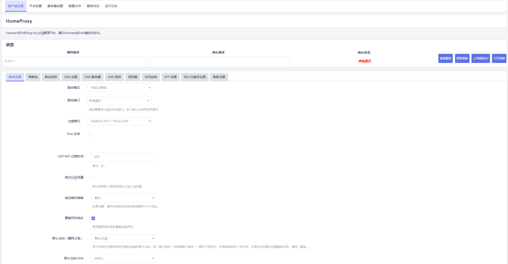
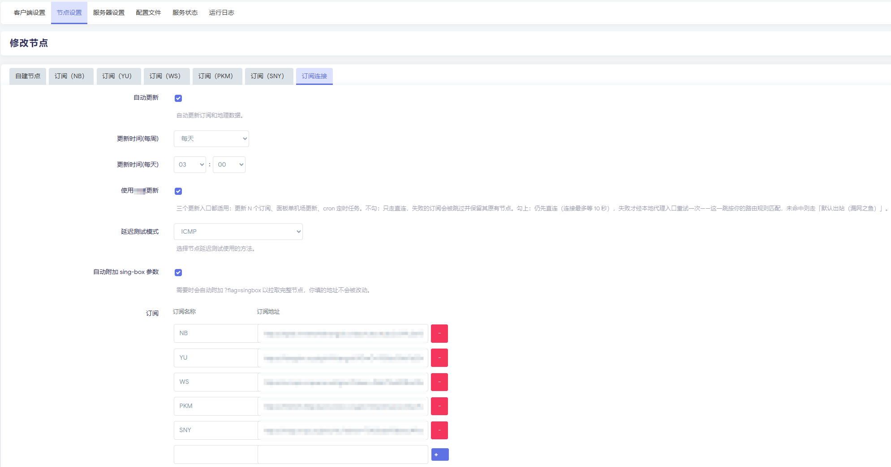
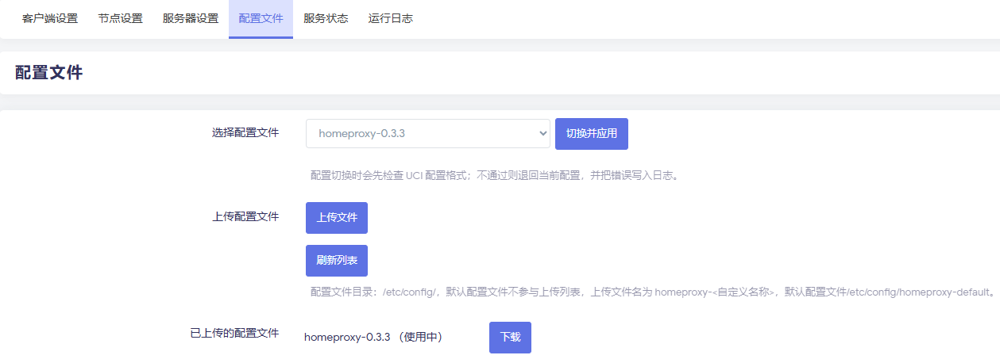
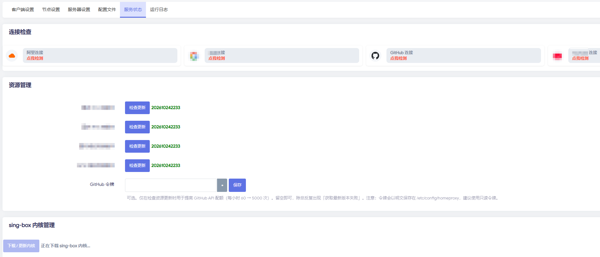
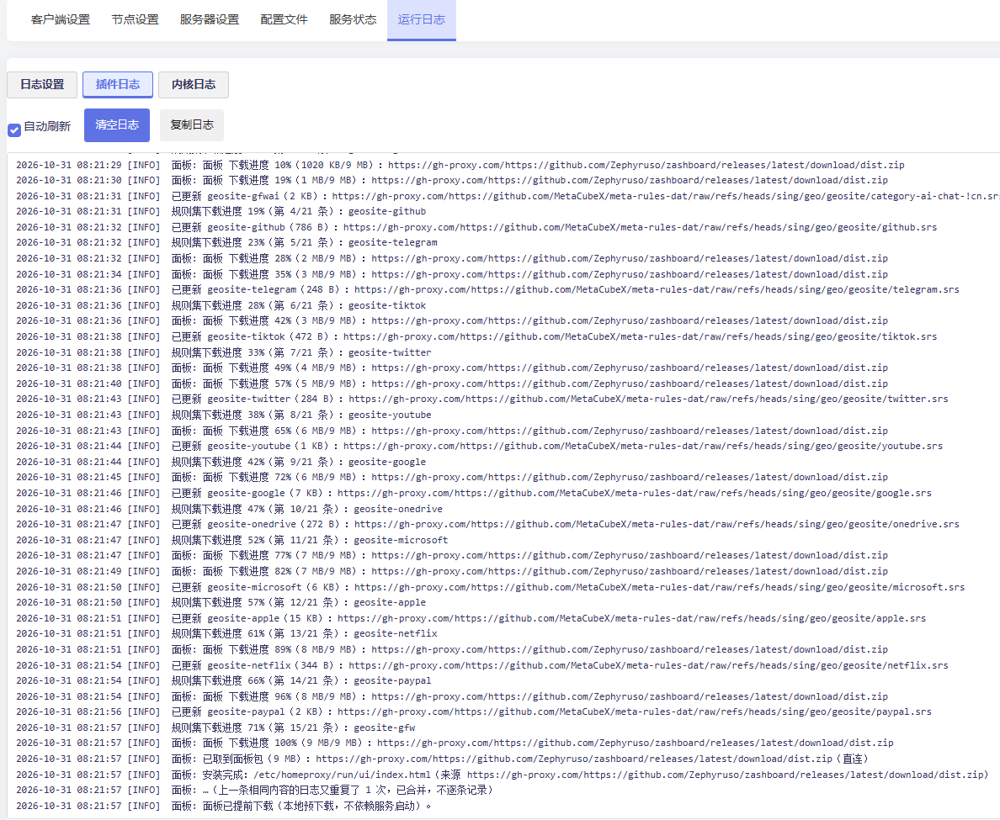
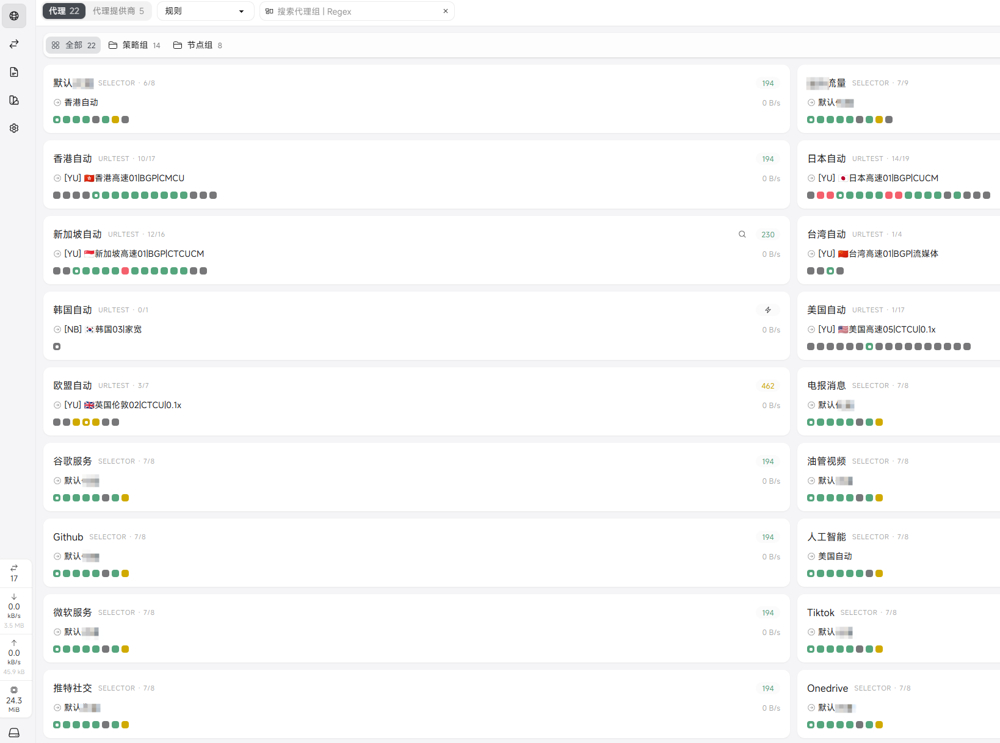

# HomeProxy for OpenWrt
适用于 OpenWrt 的 HomeProxy LuCI 管理界面，完美适配Clash API面板（基于 immortalwrt/homeproxy 修改）。

## 版本说明
支持架构：amd64 / arm64  
> OpenWrt **24.10 及更早不再提供安装包**：eBPF 透明代理需要 Linux 6.6+ 且内核编译带 `with_ebpf`，这些版本内核过低，装上也无法启用 eBPF，请升级到 25.12 后再安装。

luci-app-homeproxy_<版本>-all.apk OpenWrt 25.12 版本 LUCI 安装包  
sing-box-1.14.4-reF1nd_<版本>-linux-amd64-musl.tar.gz Amd64带补丁内核（含 with_ebpf）  
homeproxy-deploy_<版本>-amd64.zip Amd64离线安装包（含LUCI、带补丁内核）

### 系统要求（Linux eBPF 技术最小可运行配置）

低于以下配置时 eBPF 透明代理无法正常运行（可退回 redirect/tproxy 模式）：

| 项目 | 最小要求 |
| --- | --- |
| **Flash（存储）** | **最少 256 MB（overlay 可用 ≥ 100 MB）**；128 MB flash 装不下（sing-box 解压后约 78 MB），可用 U 盘 extroot 扩展 |
| **RAM（运行内存）** | **最少 256 MB（建议 512 MB）**；sing-box 稳态约 120~200 MB，128 MB 会 OOM |
| **系统** | **OpenWrt 25.12+（apk）**；24.10 及更早（opkg）不再支持 |
| **内核** | **≥ 6.6**（eBPF 用；需编译带 `with_ebpf`） |

## 界面截图
| 客户端设置 | 节点设置 |
| --- | --- |
|  |  |
| 配置文件 | 服务状态 |
|  |  |
| 运行日志 | 控制面板 |
|  |  |

> 截图中的地址、节点与订阅信息均为示例环境。

## 一、安装
### 方式一：安装 APK，内核自动下载（推荐，在线）
适合能联网、已配置软件源的路由器。装好面板后，打补丁的 reF1nd 内核会按设备架构自动下载并安装。
1. 到 Releases 下载 **OpenWrt 25.12** 的包（`<版本>` 替换成实际发布号，如 `0.4.6`）：
   - OpenWrt **25.12** → `luci-app-homeproxy_<版本>-all.apk`
2. 上传到路由器 `/tmp` 后安装：
   ```sh
   apk add --allow-untrusted /tmp/luci-app-homeproxy_*-all.apk
   ```
3. 首次启动服务时，插件会按架构自动下载并安装 reF1nd sing-box 内核（`1.14.4-reF1nd`，含 clash proxy-providers 与 Linux 内核 eBPF 支持）；也可以在 LuCI 状态页「sing-box 内核管理」中手动点「下载 / 更新内核」。
### 方式二：下载 ZIP 离线安装（含内核，无需额外下载）
适合无法联网拉取内核、或希望一次性铺好「面板 + 内核」的路由器。每个架构一个 zip，内含 luci 包（`.apk`）、打补丁内核 `sing-box`、`install.sh` 与说明。
1. 到 Releases 下载对应架构的 zip（按 `uname -m` 选择；`<版本>` 为实际发布号）：
   - `x86_64`  → `homeproxy-deploy_<版本>-amd64.zip`
   - `aarch64` → `homeproxy-deploy_<版本>-arm64.zip`
2. 上传ZIP包到路由器 `/tmp`，安装：
   ```sh
   cd /tmp && unzip -o homeproxy-deploy_*-amd64.zip && cd homeproxy-deploy_*-amd64 && sh install.sh
   ```
3. `install.sh` 会自动执行：停服务 → 安装 luci（apk 自动解决依赖，需联网或已配源）→ 铺设 `/usr/bin/sing-box` 内核 → 启动服务 → 刷新 LuCI。升级时重新跑本脚本即可（会再次覆盖内核并重装 luci）。
> 两种方式下内核版本都钉死为 `1.14.4-reF1nd_<插件版本>`（打过补丁），因此 `ensure_core` 会判定「已是最新」并跳过下载，从而保留补丁。

## 二、卸载
### OpenWrt 24.10（`opkg`）
```sh
# 1) 停用并移除软件包（会卸载 menu/acl/rpcd/脚本等已登记文件）
/etc/init.d/homeproxy stop 2>/dev/null || true
/etc/init.d/homeproxy disable 2>/dev/null || true
opkg remove luci-app-homeproxy 2>/dev/null || true
# 2) 清理 opkg 不会删的残留：连同配置文件一起清除，仅忽略面板与规则集
rm -rf /etc/config/homeproxy
# /etc/homeproxy 下除「面板 run」「规则集 ruleset」外全部删除
#   （含 config.uci.bak、current_profile、providers/ 订阅种子、cache.db、
#     score_state.json 以及运行期生成的配置/日志/锁）
find /etc/homeproxy -mindepth 1 -maxdepth 1 ! -name run ! -name ruleset -exec rm -rf {} + 2>/dev/null
# run 目录里只保留 ui（面板），其余运行期文件删掉
find /etc/homeproxy/run -mindepth 1 -maxdepth 1 ! -name ui -exec rm -rf {} + 2>/dev/null
# 只删程序文件，保留 ruleset/(规则集) 与 run/ui/(面板)：
rm -rf /etc/homeproxy/scripts
rm -rf /etc/homeproxy/resources
rm -f  /etc/capabilities/homeproxy.json
rm -f  /etc/uci-defaults/luci-homeproxy
rm -f  /etc/uci-defaults/luci-homeproxy-migration
rm -f  /www/luci-static/resources/homeproxy.js
rm -rf /www/luci-static/resources/view/homeproxy
rm -f  /usr/share/luci/menu.d/luci-app-homeproxy.json
rm -f  /usr/share/rpcd/acl.d/luci-app-homeproxy.json
rm -f  /usr/share/rpcd/ucode/luci.homeproxy
rm -f  /usr/lib/lua/luci/i18n/homeproxy.zh-cn.lmo
rm -f  /usr/bin/sing-box
# 3) 删除 homeproxy 下发的定时任务行，并移除 sing-box 专用用户/组
sed -i '/homeproxy/d' /etc/crontabs/root 2>/dev/null
/etc/init.d/cron restart 2>/dev/null || true
deluser sing-box 2>/dev/null || true
delgroup sing-box 2>/dev/null || true
# 4) 清 LuCI 缓存并重启 Web 服务
rm -f  /tmp/luci-indexcache
rm -rf /tmp/luci-modulecache/* 2>/dev/null
/etc/init.d/rpcd restart
/etc/init.d/uhttpd restart
```

### OpenWrt 25.12（`apk`）
```sh
# 1) 停用并移除软件包
/etc/init.d/homeproxy stop 2>/dev/null || true
/etc/init.d/homeproxy disable 2>/dev/null || true
apk del luci-app-homeproxy 2>/dev/null || true
# 2) 清理 apk 不会删的残留：连同配置文件一起清除，仅忽略面板与规则集
rm -rf /etc/config/homeproxy
# /etc/homeproxy 下除「面板 run」「规则集 ruleset」外全部删除
#   （含 config.uci.bak、current_profile、providers/ 订阅种子、cache.db、
#     score_state.json 以及运行期生成的配置/日志/锁）
find /etc/homeproxy -mindepth 1 -maxdepth 1 ! -name run ! -name ruleset -exec rm -rf {} + 2>/dev/null
# run 目录里只保留 ui（面板），其余运行期文件删掉
find /etc/homeproxy/run -mindepth 1 -maxdepth 1 ! -name ui -exec rm -rf {} + 2>/dev/null
# 只删程序文件，保留 ruleset/(规则集) 与 run/ui/(面板)：
rm -rf /etc/homeproxy/scripts
rm -rf /etc/homeproxy/resources
rm -f  /etc/capabilities/homeproxy.json
rm -f  /etc/uci-defaults/luci-homeproxy
rm -f  /etc/uci-defaults/luci-homeproxy-migration
rm -f  /www/luci-static/resources/homeproxy.js
rm -rf /www/luci-static/resources/view/homeproxy
rm -f  /usr/share/luci/menu.d/luci-app-homeproxy.json
rm -f  /usr/share/rpcd/acl.d/luci-app-homeproxy.json
rm -f  /usr/share/rpcd/ucode/luci.homeproxy
rm -f  /usr/lib/lua/luci/i18n/homeproxy.zh-cn.lmo
rm -f  /usr/bin/sing-box
# 3) 删除定时任务行，并移除 sing-box 专用用户/组
sed -i '/homeproxy/d' /etc/crontabs/root 2>/dev/null
/etc/init.d/cron restart 2>/dev/null || true
deluser sing-box 2>/dev/null || true
delgroup sing-box 2>/dev/null || true
# 4) 清 LuCI 缓存并重启 Web 服务
rm -f  /tmp/luci-indexcache
rm -rf /tmp/luci-modulecache/* 2>/dev/null
/etc/init.d/rpcd restart
/etc/init.d/uhttpd restart
```
> 说明：
> - 卸载时**仅忽略面板（`/etc/homeproxy/run/ui`）与规则集（`/etc/homeproxy/ruleset`）**。

## 三 、备份配置
备份 /etc/config/homeproxy

## 四 、常见问题
1. **面板下载失败**
   - 客户端设置 → 点「更新面板」手动触发；
   - 或手动下载 ZIP 上传：`https://github.com/Zephyruso/zashboard/releases/latest/download/dist.zip`，客户端设置 → 点「上传面板ZIP」。
2. **远程规则集是否下载成功**
   面板查看，有即成功或者SSH 查看 `/etc/homeproxy/ruleset/`，否则检查规则集远程连接。
3. **内核未安装或下载失败**
   服务状态 → 「内核管理」查看架构与目标版本；显示"未安装"则点「下载 / 更新内核」。若当前架构 reF1nd 暂未发布，请等作者更新。

## 五、感谢作者
- immortalwrt：https://github.com/immortalwrt/homeproxy
- reF1nd（sing-box 内核基础源码）：https://github.com/reF1nd/sing-box （v1.14.4-reF1nd）
